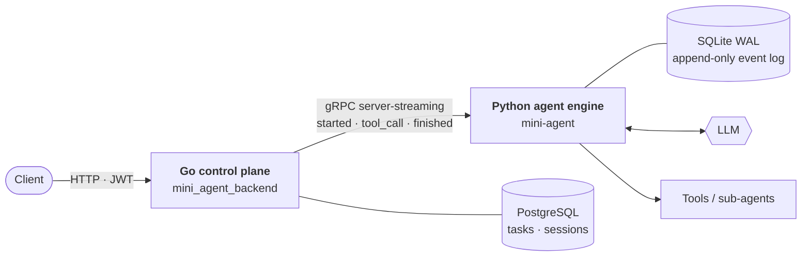
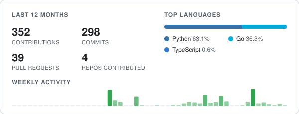

<h1 align="center">Hi, I'm Jarwood 👋</h1>

  <b>Backend &amp; AI-Agent Engineer</b> &nbsp;·&nbsp; I build agent runtimes that survive <code>kill -9</code>.

  
  
  
  
  
  
  
  
  
  
  

---

### 🧭 About

- 🎓 3rd-year CS undergrad, writing **Python** daily and **Go** for services.
- 🔧 Building **Mini-Agent** — a crash-recoverable AI agent runtime: a Python execution engine and a Go control plane talking over gRPC streaming.
- 🧠 What I care about: idempotency, crash recovery, state machines, backpressure &amp; cancellation — the boring parts that keep agents correct.
- 🌱 Contributing to open-source agent infrastructure.
- 📫 Open to **backend / AI-agent internships**.

### 🚀 Featured Projects

| Project | Stack | The interesting part |
|:--|:--|:--|
| [**mini-agent**](https://github.com/Jepson-Wang/mini-agent) | Python · gRPC · SQLite WAL | `SIGKILL` it mid-tool-call, `--resume`, and it carries on — no lost turns, no tool run twice |
| [**mini_agent_backend**](https://github.com/Jepson-Wang/mini_agent_backend) | Go · Gin · GORM · PostgreSQL | Task control plane with CAS state transitions, a circuit breaker on the agent link, and a reaper that finalizes stuck tasks without re-running them |
| [**question_set_program**](https://github.com/Jepson-Wang/question_set_program) | FastAPI · LangGraph · Chroma | ReAct tutoring agent with hot-reloadable `SKILL.md` packs and 3-tier memory (Redis / MySQL / vector) |

<b>How Mini-Agent fits together</b> (click to expand)

 

**Crash recovery** — every message is appended before its side effects run. On `--resume`, the log is replayed and each tool call is matched against an idempotency table keyed by `tool_call_id`: finished calls get their stored result, unfinished ones become explicit error results so the LLM decides whether to retry. Verified by real `SIGKILL` tests at multiple failure points.

**Streaming &amp; cancellation** — a bounded queue bridges the blocking agent loop to gRPC server-streaming; cancellation ends the stream with a clean EOF instead of an abort, so it never trips the client-side breaker.

**State machine** — task transitions are a single `UPDATE … WHERE status IN (…)` judged by rows affected, so concurrent writers can't race a task into an illegal state.

### 🤝 Open-Source Contributions

| Project | What I shipped |
|:--|:--|
| [**ethanhq/cc-fleet**](https://github.com/ethanhq/cc-fleet)  Go · ★ 185 · runs Claude Code subagents on any model | **3 merged PRs** — exact proxy-port matching for workers ([#145](https://github.com/ethanhq/cc-fleet/pull/145)), version resolution that works across PowerShell editions ([#56](https://github.com/ethanhq/cc-fleet/pull/56)), ASCII installer banners to fix cp936 mojibake ([#59](https://github.com/ethanhq/cc-fleet/pull/59)) · putting the Claude worker behind an `Engine` interface — in review ([#146](https://github.com/ethanhq/cc-fleet/pull/146)) |
| [**NousResearch/hermes-agent**](https://github.com/NousResearch/hermes-agent)  Python · ★ 257k | A trace-only compression summary now fails instead of silently becoming the checkpoint — in review ([#139989](https://github.com/NousResearch/hermes-agent/pull/139989)) |

### 🌍 Latest Pull Requests

<!-- OSS:START -->
- 🟡 **ethanhq/cc-fleet** ★ 185 — [feat(subagent): prepare the codex engine's CODEX_HOME](https://github.com/ethanhq/cc-fleet/pull/149) (#149) · _in review_
- 🟡 **ethanhq/cc-fleet** ★ 185 — [refactor(subagent): put the claude worker behind an Engine interface; resolve the codex binary](https://github.com/ethanhq/cc-fleet/pull/146) (#146) · _in review_
- 🟣 **ethanhq/cc-fleet** ★ 185 — [fix(codexproxy): match a worker's proxy port exactly, not as a substring](https://github.com/ethanhq/cc-fleet/pull/145) (#145) · merged
- 🟡 **NousResearch/hermes-agent** ★ 258.9k — [fix(compression): a trace-only summary fails instead of becoming the checkpoint](https://github.com/NousResearch/hermes-agent/pull/139989) (#139989) · _in review_
- 🟣 **ethanhq/cc-fleet** ★ 185 — [fix: keep install.ps1 banners ASCII to avoid cp936 mojibake](https://github.com/ethanhq/cc-fleet/pull/59) (#59) · merged
<!-- OSS:END -->

### 📊 Stats

  <picture>
    <source media="(prefers-color-scheme: dark)" srcset="assets/stats-dark.svg">
    
  </picture>

Stats and activity refresh daily via GitHub Actions — <a href="scripts/update_profile.py">built from scratch</a>, no third-party widgets.

