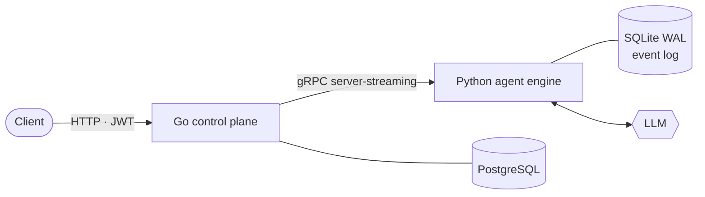

<h1 align="center">Hi, I'm Jarwood 👋</h1>

  <b>Backend &amp; AI-Agent Engineer</b> · I build agent runtimes that survive <code>kill -9</code>.

  
  
  
  
  
  
  
  

- 🔧 Building **Mini-Agent** — a crash-recoverable agent runtime: Python engine + Go control plane over gRPC streaming.
- 🧠 Into the parts that keep agents correct: idempotency, crash recovery, backpressure &amp; cancellation.
- 🎓 3rd-year CS undergrad · open to **backend / AI-agent internships**.

### 🚀 Projects

| | |
|:--|:--|
| [**mini-agent**](https://github.com/Jepson-Wang/mini-agent) · Python | `SIGKILL` it mid-tool-call, `--resume`, and it carries on — no tool runs twice |
| [**mini_agent_backend**](https://github.com/Jepson-Wang/mini_agent_backend) · Go | Task control plane: CAS state transitions, circuit breaker, stuck-task reaper |
| [**question_set_program**](https://github.com/Jepson-Wang/question_set_program) · Python | LangGraph ReAct tutor with hot-reloadable skills and 3-tier memory |

How Mini-Agent fits together

 

- **Crash recovery** — messages are persisted before side effects; on resume, an idempotency table keyed by `tool_call_id` returns finished results and turns unfinished calls into explicit errors for the LLM to handle.
- **Cancellation** — ends the stream with a clean EOF, so it never trips the client's circuit breaker.
- **State machine** — one `UPDATE … WHERE status IN (…)`, judged by rows affected.

### 🤝 Open Source

<!-- OSS:START -->
- **ethanhq/cc-fleet** ★ 185 — 3 merged · 1 in review: [#146](https://github.com/ethanhq/cc-fleet/pull/146 "refactor(subagent): put the claude worker behind an Engine interface; resolve the codex binary") [#145](https://github.com/ethanhq/cc-fleet/pull/145 "fix(codexproxy): match a worker's proxy port exactly, not as a substring") [#59](https://github.com/ethanhq/cc-fleet/pull/59 "fix: keep install.ps1 banners ASCII to avoid cp936 mojibake") [#56](https://github.com/ethanhq/cc-fleet/pull/56 "fix: make install.ps1 latest-version resolution robust across PowerShell editions")
- **NousResearch/hermes-agent** ★ 257.3k — 1 in review: [#139989](https://github.com/NousResearch/hermes-agent/pull/139989 "fix(compression): a trace-only summary fails instead of becoming the checkpoint")
<!-- OSS:END -->

  <picture>
    <source media="(prefers-color-scheme: dark)" srcset="assets/stats-dark.svg">
    
  </picture>
   Stats and PRs refresh daily via a <a href="scripts/update_profile.py">self-written</a> GitHub Action.

